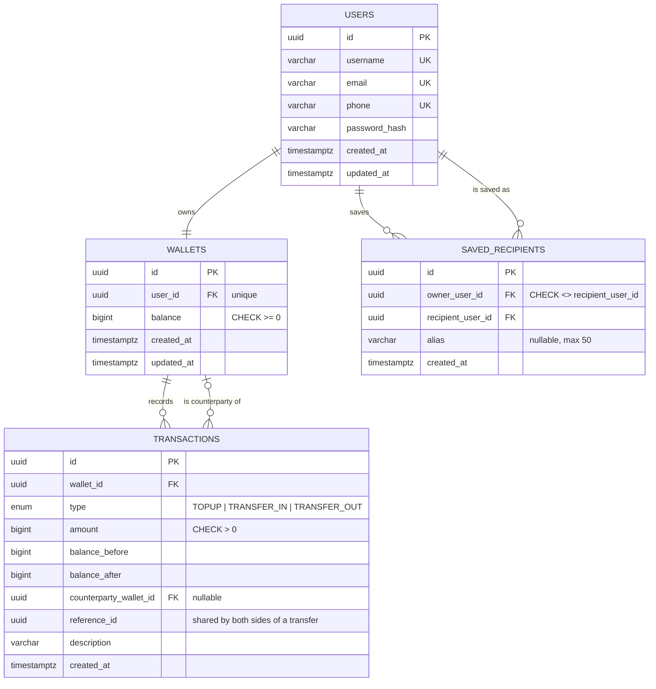

# Mini Wallet API & Dashboard

A simple digital wallet: users register, log in, top up their balance, transfer money to other users by email or phone number, and see their transaction history.

- **Backend:** REST API with JWT authentication (httpOnly cookie), database transactions with row locking for transfers, and strict input validation.
- **Frontend:** React single-page dashboard with login, register, balance, top-up, transfer, and paginated transaction history.

## Tech stack

| Layer | Technology |
| --- | --- |
| Runtime | Node.js 20+ |
| API | Express 5 |
| Database | PostgreSQL |
| ORM / migrations | Prisma 6 |
| Validation | Zod 4 |
| Auth | jsonwebtoken, bcrypt, httpOnly cookie |
| Security | helmet, cors, express-rate-limit |
| Tests | Vitest + Supertest (against a real PostgreSQL test database) |
| Frontend | React 18, Vite 6, React Router 7, Axios, Tailwind CSS 4 |

## Architecture

```
React SPA ──HTTPS + httpOnly cookie──▶ Express API ──▶ PostgreSQL
                                        routes
                                          └─ middlewares (auth, validate, rate limit)
                                               └─ controllers   (HTTP in/out only)
                                                    └─ services (business rules, DB transactions)
                                                         └─ Prisma models
```

The backend follows MVC with an extra service layer:

- **Model** – `backend/prisma/schema.prisma` (tables, relations, constraints).
- **View** – JSON responses shaped by `backend/src/utils/serializers.js`; the React app renders them.
- **Controller** – `backend/src/controllers/*` read validated input and send responses.
- **Service** – `backend/src/services/*` hold business logic such as the transfer transaction.

## Entity relationship diagram



Design notes:

- Money is stored as `BIGINT` whole Rupiah, never as floating point.
- `CHECK (balance >= 0)` makes the database reject a negative balance even if application code has a bug.
- `transactions` is a ledger per wallet. A transfer writes two rows (`TRANSFER_OUT` for the sender and `TRANSFER_IN` for the recipient) with the same `reference_id`.
- Index on `(wallet_id, created_at DESC)` keeps paginated history queries fast.
- `saved_recipients` is each user's address book. It stores the recipient's user id, not the email text, and a unique `(owner_user_id, recipient_user_id)` index blocks duplicates. Only registered users can be saved, using the same email/phone lookup as transfers.

## How a transfer stays consistent

1. Validate input (amount must be a positive whole number up to Rp10.000.000).
2. Find the recipient by email or phone; reject unknown recipients (404) and self-transfers (400).
3. In one database transaction:
   1. Lock both wallets with `SELECT ... FOR UPDATE`, always in id order to avoid deadlocks.
   2. Reject with 400 `Saldo tidak cukup.` if the sender balance is too low.
   3. Update both balances and insert both ledger rows.
4. Any error inside the transaction rolls back every step.

A test sends five parallel transfers of Rp20.000 from a Rp50.000 balance and checks that exactly two succeed.

## API

Base URL: `/api`. Protected endpoints read the JWT from the `access_token` httpOnly cookie (or an `Authorization: Bearer` header).

| Method | Endpoint | Auth | Body / query | Success | Errors |
| --- | --- | --- | --- | --- | --- |
| POST | `/auth/register` | – | `username, email, phone, password` | 201 | 422 |
| POST | `/auth/login` | – | `email, password` | 200 + cookie | 422, 401 |
| POST | `/auth/logout` | ✓ | – | 200 | 401 |
| GET | `/auth/me` | ✓ | – | 200 | 401 |
| GET | `/wallet` | ✓ | – | 200 | 401 |
| GET | `/wallet/summary` | ✓ | – (balance, totalIn, totalOut, 7-day `daily`) | 200 | 401 |
| POST | `/topup` | ✓ | `amount` | 200 | 422, 401 |
| POST | `/transfer` | ✓ | `recipient, amount, note?` | 200 | 422, 400, 404, 401 |
| GET | `/transactions` | ✓ | `?page=1&limit=10&type=TOPUP` | 200 | 422, 401 |
| GET | `/recipients` | ✓ | – | 200 | 401 |
| POST | `/recipients` | ✓ | `identifier` (email or phone), `alias?` | 201 | 422, 400, 404, 401 |
| DELETE | `/recipients/:id` | ✓ | – | 200 | 422, 404, 401 |

Error response format:

```json
{
  "success": false,
  "message": "Validasi gagal.",
  "errors": [{ "field": "amount", "message": "Nominal harus berupa angka." }]
}
```

| Status | Used for |
| --- | --- |
| 400 | Business rule violated (insufficient balance, transfer to yourself, malformed JSON) |
| 401 | Missing, invalid, or expired token; wrong email or password |
| 404 | Transfer or saved recipient not found; saved recipient that belongs to another user |
| 422 | Field validation failed (invalid email, short password, taken username, invalid amount) |

## Running locally

Requirements: Node.js 20+, PostgreSQL 14+.

### 1. Backend

```bash
cd backend
cp .env.example .env          # then set DATABASE_URL and JWT_SECRET
npm install
npx prisma migrate deploy     # create tables
npm run db:seed               # optional demo users
npm run dev                   # http://localhost:4000
```

Demo users created by the seed: `pratitis@example.com` and `yohanes@example.com`, password `password123`.

### 2. Frontend

```bash
cd frontend
cp .env.example .env
npm install
npm run dev                   # http://localhost:5173
```

The Vite dev server proxies `/api` to the backend, so the auth cookie works without extra settings.

### 3. Tests

```bash
cd backend
cp .env.test.example .env.test   # point DATABASE_URL to a separate database whose name contains "test"
npm test
```

The test setup refuses to run unless the database name contains `test`, because every table is truncated between tests.

## Deployment

- **Database:** Neon, Supabase, or Railway PostgreSQL. Run `npm run db:deploy` once.
- **API:** Railway or Render. Set `NODE_ENV=production`, `DATABASE_URL`, `JWT_SECRET`, and `CORS_ORIGINS` (the frontend URL).
- **Frontend:** Vercel. Replace `YOUR-API-DOMAIN` in `frontend/vercel.json`. The rewrite serves the API under the frontend's own domain, so the cookie stays first-party and `COOKIE_SAME_SITE=lax` works. Without the rewrite, use `COOKIE_SAME_SITE=none` and `COOKIE_SECURE=true` and set `VITE_API_BASE_URL` to the full API URL.

## Project structure

```
backend/
  prisma/            schema, migrations, seed
  src/
    config/          environment and constants
    controllers/     HTTP handlers
    middlewares/     auth, validation, rate limit, error handling
    routes/          route definitions
    services/        business logic and database transactions
    utils/           errors, tokens, cookies, serializers
    validators/      Zod schemas
  tests/             unit and integration tests
frontend/
  src/
    api/             Axios client and API calls
    components/      UI components
    context/         auth state
    hooks/           data and submit hooks
    pages/           Login, Register, Dashboard
    routes/          route guards
    validators/      client-side validation (mirrors the backend)
```
